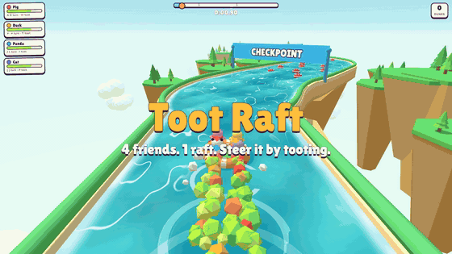

# Toot Raft

**One raft, up to four bottoms. Get it down the river together.**

### ▶ Play free in your browser: **[toot.honkpop.com](https://toot.honkpop.com)**

*Click the preview for the full trailer with sound.*

---

## What is it?

Up to four animals share one inflatable raft, and the only way to move it is to **toot**.
Every animal pushes from the spot where it sits, so tooting from one side spins the raft.
To go straight, everyone has to toot at the same moment, in the same direction.
Friendships will be tested.

- **Free, no install.** Runs in any modern browser on laptops and phones.
- **Play together on one keyboard** (up to 4), or **online**: make a room, send the link, and each friend plays from their own device.
- **Team Race:** two rafts, two teams of up to 4. First raft down the river wins.
- **Works on phones.** Turn your phone sideways, aim with your left thumb, hold TOOT with your right. Add it to your home screen to play full screen.

## How to play

| Rider | Aim | Toot |
|---|---|---|
| 🐷 Pig | `A` / `D` | `W` |
| 🦆 Duck | `←` / `→` | `↑` |
| 🐼 Panda | `J` / `L` | `I` |
| 🐱 Cat | `[` / `]` | `P` |

- **Controllers:** stick aims, A or RT toots. Each controller takes the next rider.
- **Phones:** drag your left thumb toward where you want to push, hold **TOOT** with your right.
- Your gas runs out if you toot for too long. Watch the bar and let it refill.
- Spikes pop the raft, and the open edges drop you off the island. Both send you back to the last checkpoint.
- Mines blast the raft sideways. They grow back after a few seconds.
- Crocodiles swim across the river. Their body bounces you off, but stay away from the open jaws.

## Levels

1. **Lazy Lagoon**: rocks, gentle bends and a small waterfall. Start here.
2. **Spike Canyon**: crusher gates, a drawbridge, bumper buoys, a wind fan and your first uphill climb.
3. **Mine Bay**: a bay full of mines, whirlpools, swinging logs and crocodiles.
4. **Rapids Run**: rapids, waterfalls, open edges, swinging logs, crocodiles and three climbs.
5. **Grand Gauntlet**: spike rings, moving spike walls, crushers, crocodiles and everything else at once.

More levels are coming.

## Feedback

Found a bug, got stuck, or have an idea for a level? [Open an issue](https://github.com/Gourav2609/toot-raft/issues). Screenshots and your device type help a lot.

---

Made by [Gourav](https://x.com/gourav_io) · part of [honkpop.com](https://honkpop.com)
